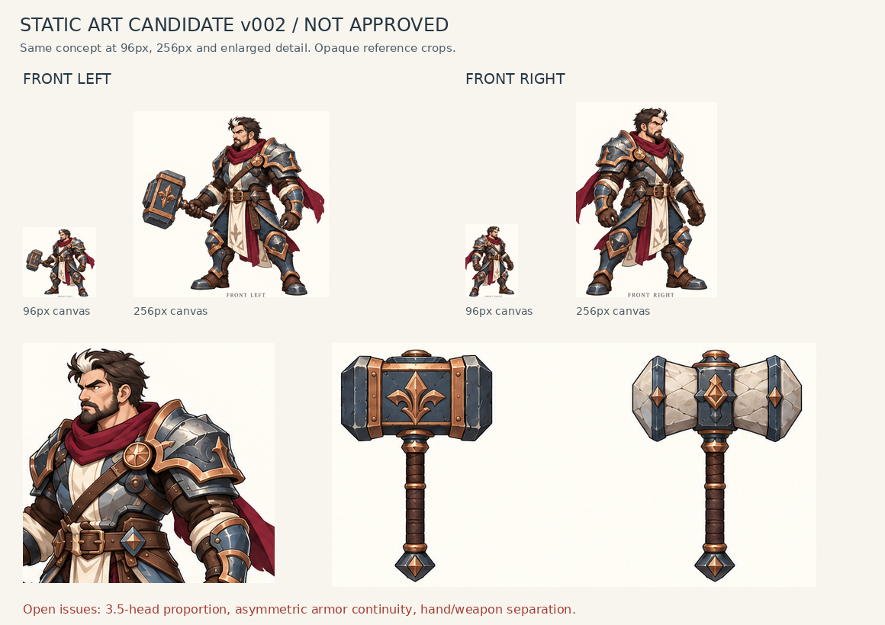
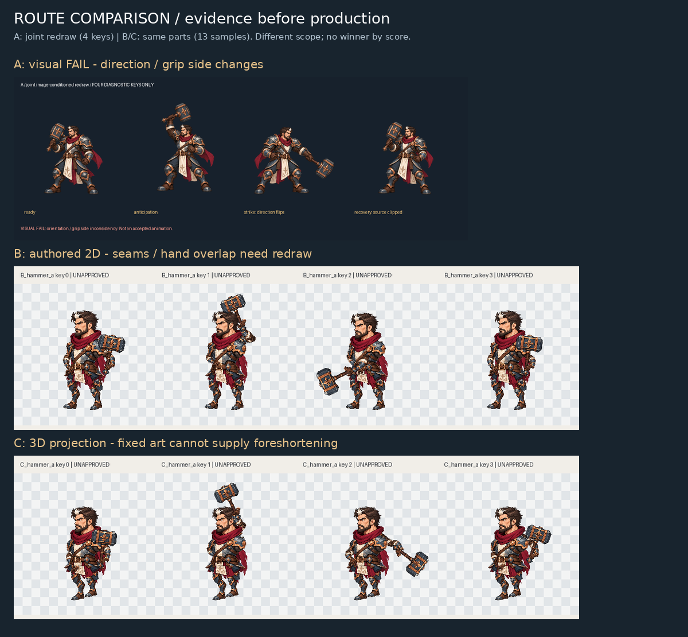

# AI Game Art Factory：已有图片恢复交付

> 最新交付：[持锤战士 2D 动作与 GIF](warrior-v002/README.md)。包含双方向、待机/攻击/防御、PNG 图集和 GIF 合集，基于公开人体骨架重新制作，待美术验收。
>
> 用户已否决下面旧实验的人形结果，保留这些文件仅用于失败对照。人体来源和骨架基线见：[公开人体参照与动作基线](public-reference-baseline/README.md)。

这里保存本次实验已有图片的逐字节副本，没有重新生成、缩放、转码或用占位图替换。原文件仍保留在云端项目目录。图片内容仍属于未通过美术验收的实验，恢复交付不改变其验收状态。

## 先看这些文件

| 内容 | 文件 |
|---|---|
| 静态角色、两方向、两把锤子 | [静态审查板](review-materials/static-review.png) |
| A/B/C 路线对照 | [路线对比图](review-materials/route-comparison.png) |
| Godot 真实截图 | [实际显示尺寸截图](review-materials/parts_experiment/godot-actual-size.png) |
| 两版原始概念图 | [v001](source-assets/references/warrior-concept-v001.png) · [v002](source-assets/references/warrior-concept-v002.png) |
| 原始透明部件图集 | [warrior-parts-v001.png](source-assets/characters/warrior-parts-v001.png) |
| A 原始联合关键姿态图 | [joint-keyposes-v001.png](source-assets/characters/route_a/joint-keyposes-v001.png) |
| 两把独立武器 | [hammer_a.png](source-assets/weapons/hammer_a.png) · [hammer_b.png](source-assets/weapons/hammer_b.png) |
| B 动画 | [锤 A](review-materials/parts_experiment/B_hammer_a.webp) · [锤 B](review-materials/parts_experiment/B_hammer_b.webp) |
| C 动画 | [锤 A](review-materials/parts_experiment/C_hammer_a.webp) · [锤 B](review-materials/parts_experiment/C_hammer_b.webp) |
| A 诊断播放 | [APNG](review-materials/route_a/diagnostic-keyposes.apng) |
| Blender 结构输入 | [结构接触表](review-materials/structure/contact-sheet.png) · [引导通道](review-materials/structure/guide-channels.png) |

## 目录和完整性

- `source-assets/`：原始角色、部件和武器图。
- `review-materials/`：已有静态审查图、动画、Godot截图和结构引导图。
- `exports/`：逐帧合成与分层 PNG、Sprite Sheet、拆分部件。
- [copy-manifest.json](copy-manifest.json)：每个仓库路径、原云端路径、字节大小、SHA-256。复制后已核对内容一致。
- [image-recovery-audit.json](image-recovery-audit.json)：逐文件实际路径、尺寸、模式、帧数、逐帧解码结果、SHA-256和原始工具输出映射。
- [image-recovery-audit.md](image-recovery-audit.md)：审计摘要与扫描限制。

在 GitHub 中打开相应文件，可用文件页的原始文件或下载功能获取原图。若聊天内嵌预览未显示，仍可通过本仓库目录获取文件；聊天显示状态不是文件保存的证据。
