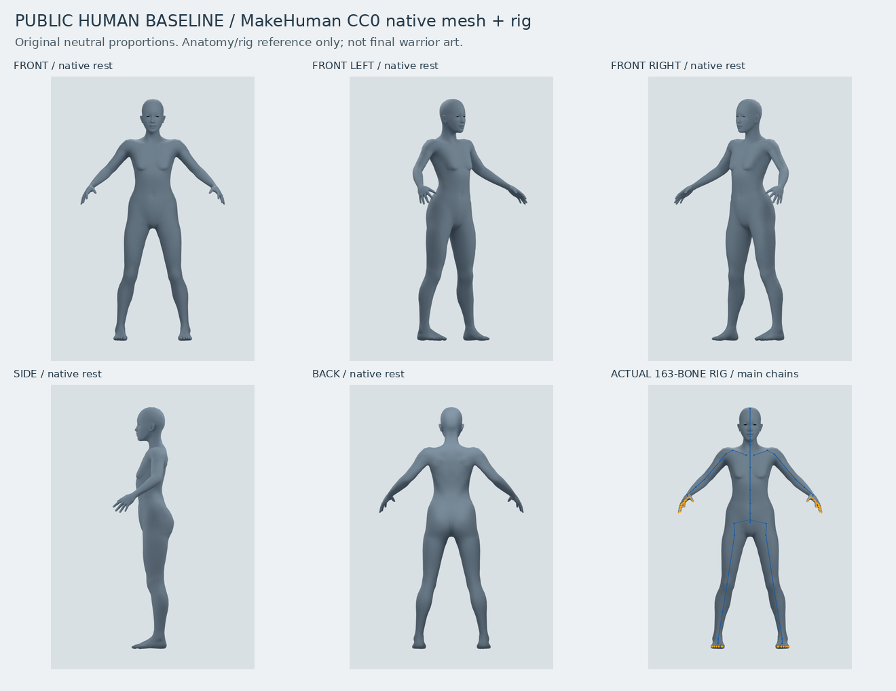
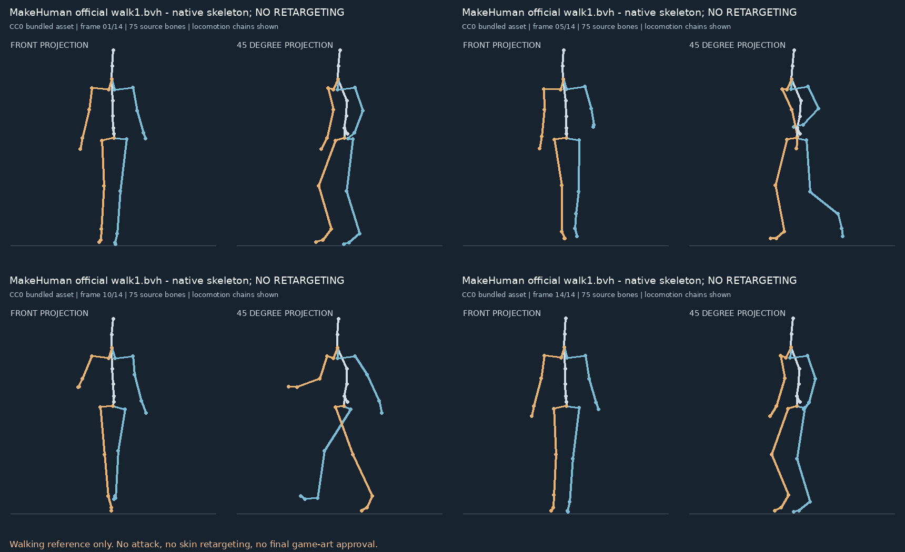

# 公开人体素体与原生动作基线

这轮先使用有明确授权的公开资料建立人体结构，不沿用此前失败的部件拼接。主参照是 MakeHuman 官方 CC0 连续人体网格、默认163骨父子层级与官方蒙皮权重，保留原始自然比例。

## 先看人体

[五视角与骨架对照](anatomy/contact-sheet.png) · [手部细节](anatomy/right-hand-readable.png) · [真实骨架覆盖](anatomy/native-rig-overlay.png) · [局部蒙皮屈伸测试](anatomy/authored-elbow-skin-test.webp)

这是解剖与绑定参照，尚不是3.5头身男性英雄或2D成品。局部屈伸是明确标记的自制蒙皮诊断，不是下载的战斗动作。

## 再看公开动作骨架

[官方行走BVH接触表](motion/walk1-native-skeleton-contact.png) · [14帧原生骨架播放](motion/walk1-native-skeleton.webp)

walk1 使用旧的75骨命名；已按原生数据播放，**尚未重定向到上方163骨人体，也不是持锤攻击**。侧重确认连续动作及骨架结构，下一步才处理映射、静止姿态、单位和脚接触。

## 文件与来源

- [MakeHuman固定版本源文件与CC0许可](../../../ai-game-art-factory/assets/public_references/makehuman/)
- [Blender人体场景](../../../ai-game-art-factory/workflows/blender/public_human_baseline.blend)
- [实际人体导入脚本](../../../ai-game-art-factory/workflows/blender/public_human_baseline.py)
- [选型、授权与使用说明](../../../ai-game-art-factory/docs/公开素体与动作骨架选型.md)
- [人体技术检查](../../../ai-game-art-factory/reports/public_human/baseline-qa.json)
- [来源及新输出校验记录](../../../ai-game-art-factory/reports/public-reference-validation.json)

原始MakeHuman资产来自 [makehumancommunity/makehuman](https://github.com/makehumancommunity/makehuman)，提交 `a8bc2d54ff0ac92e78ff71431b1023eda42bf482`，bundled数据为CC0；原程序代码的AGPL许可未混同为资产许可。

目录 `motion/riggedfigure*` 和其子目录仅是附属glTF skin兼容性测试，**不推荐该方头低模人物作人体造型参照**。其来源为Khronos glTF-Sample-Assets中的RiggedFigure，©2017 Cesium，[CC BY 4.0](https://creativecommons.org/licenses/by/4.0/)，来源提交 `15cd02d304e54cb42a4db4eefe719f76190f4b68`。模型/原生动画保留，另作灰色光照渲染、视图缩放和接触表排版；版权、许可证全文和改动说明均随附在 [来源目录](../../../ai-game-art-factory/assets/public_references/riggedfigure/)。

所有新预览均从上述真实公开网格/骨架渲染或投影，没有调用AI图像生成服务。技术检查通过不等于人工美术验收。
