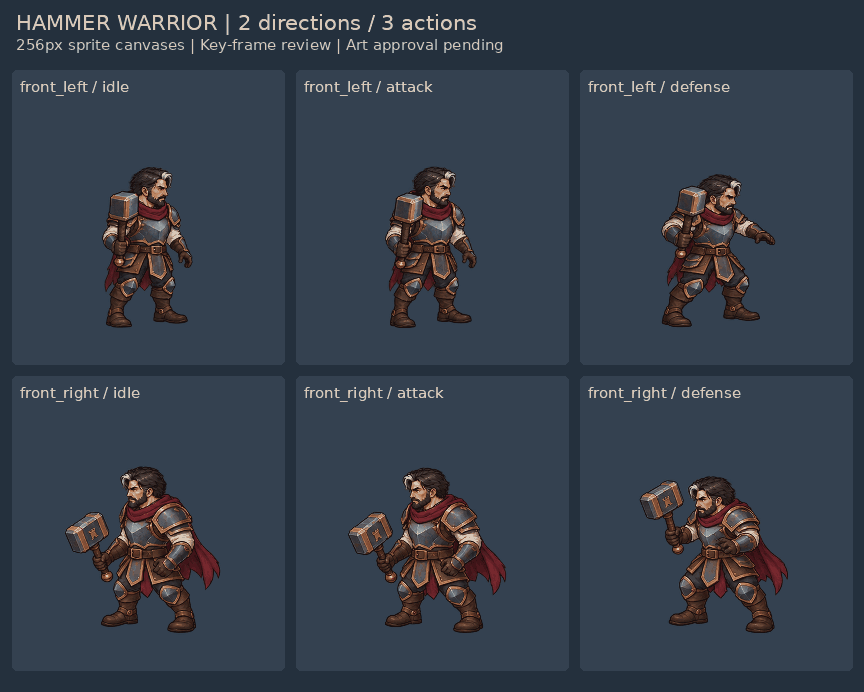

# 持锤战士：动作与 2D 美术样板

左右两个真实观察方向，待机 / 攻击 / 防御，32 张 256×256 透明 PNG。以下是实际导出的绘制帧；结构引导另存。原图、修正过程、脚本、原生 Blender 骨架与来源许可证保留在工程目录。

## 先看 GIF

[打开 GIF 合集](actions-comparison.gif) · [下载素材包](warrior-v002-game-assets.zip) · [Godot 实际画面](godot-actual-size.png)

| 方向 | 待机 | 攻击 | 防御 |
| --- | --- | --- | --- |
| 左前观察方向，角色面向画面右 | [GIF](sprites/front_left/preview-idle.gif) | [GIF](sprites/front_left/preview-attack.gif) | [GIF](sprites/front_left/preview-defense.gif) |
| 右前观察方向，角色面向画面左 | [GIF](sprites/front_right/preview-idle.gif) | [GIF](sprites/front_right/preview-attack.gif) | [GIF](sprites/front_right/preview-defense.gif) |

GIF 使用固定深灰预览底和调色板；透明资产使用 PNG、WebP 或 APNG。待机 1000ms，攻击 870ms，防御 700ms。合集重复展示动作；游戏元数据将攻击、防御标为单次播放。

## 图集与设计

- [左前方向图集](sprites/front_left/atlas.png) / [JSON](sprites/front_left/atlas.json) / [96、128px 审查图](sprites/front_left/contact-review.png)
- [右前方向图集](sprites/front_right/atlas.png) / [JSON](sprites/front_right/atlas.json) / [96、128px 审查图](sprites/front_right/contact-review.png)
- [双视图及两把锤子的原始设计](art/design-original.png)
- 独立静态武器：[矩形锤](weapons/hammer_block.png)、[月牙锤](weapons/hammer_crescent.png)
- [人体动作引导](motion-guides/) · [完整实现及审查记录](../../../ai-game-art-factory/docs/持锤战士第二版.md)

当前为待美术验收的动画样板。人体、双手、衣装和挥锤阶段已经可读；部分防御帧锤头遮脸，攻击关键帧仍有局部衣装重画差异和衔接顿挫风险。角色约 4 头身，未宣称精确达到 3.5。第二把锤子目前只有独立静态设计；动态换装和身体/武器/前景手的分层重组尚未完成。

右向原始草稿曾有三帧朝向错误，正式图集已经使用一组正确朝向的补画帧替换，未用镜像或删帧掩盖。工程保留原草稿作追溯；应以本页的 `sprites/*/atlas.png` 和动画为交付版本。

`manifest.json` 逐文件记录真实来源、大小、尺寸、动画解码帧数与 SHA-256。素材包保留 `exports/warrior_v002` 与 `workflows/godot-warrior` 的相对目录，可用 Godot 4 打开后者的 `project.godot` 播放。
